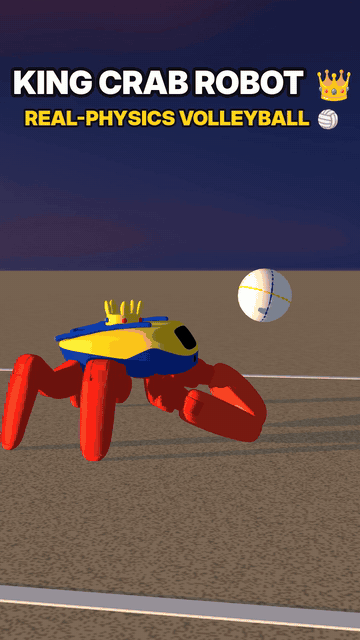
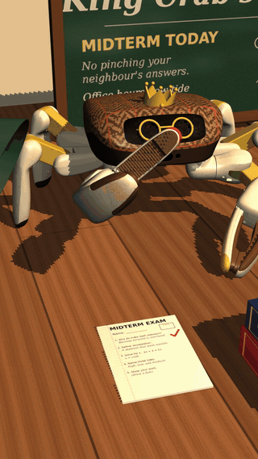

# King Crab 👑🦀 — Jumper Crab Robot Challenge Entries

<p align="center"></p>

Custom skins, maps and apps for **Jumper**, KingKong Robotics' open-source 22-joint crab robot,
made for the **KingKong Robotics Crab Robot Challenge 2026**. King Crab is Jumper in a crown: a
#1-jersey beach-volleyball star in one entry and a tweed-wearing professor in the other. Everything
was built with the official [jumper](https://github.com/KingKongRobotics/jumper) and
[jumper-design](https://github.com/KingKongRobotics/jumper-design) toolkits, and every motion is
one of Jumper's shipped trained policies.

## Entries

| | Video | Links |
|---|---|---|
| 🏐 | **Volleyball**: King Crab bumps a volleyball over the net, then celebrates | [YouTube](https://youtube.com/shorts/sH8cxCwxHX0) · [Instagram](https://www.instagram.com/kingcrabjump/reel/DgL_5XRheXv/) · [X](https://x.com/kingcrabjumper/status/2125776342222549370) |
| 📝 | **Professor grades midterm**: King Crab picks up a midterm, reads it, gives it an F, then finds an A+ | [YouTube](https://youtube.com/shorts/Z0_Pp0wQ7TM) · [Instagram](https://www.instagram.com/kingcrabjump/reel/DgMFsOihklK/) |

<p align="center"></p>

## What's custom

**Skins** (`skins/`, `kk-skin-package/3`, display-only, verified against Jumper's trusted profile)

| File | What it is |
|---|---|
| `king-crab-gold-1.skin` | Volleyball King Crab: a yellow #1 jersey with blue piping, a gold crown with red and blue jewels, blue lower body, red legs and claws. |
| `king_crab_professor.skin` | Professor King Crab: herringbone tweed with a rust overcheck, a gold crown, round gold glasses, and a red "pen" tip on the right claw. |

**Maps** (`maps/`, `kk-scene-package/2`, each bundles its King Crab as the default robot)

| File | What it is |
|---|---|
| `beach-volleyball-court.map` | A robot-scale sand court with the net 0.9 m in front of the spawn (the animated-ball cut). |
| `beach-volleyball-real-ball.map` | The same court with the net 0.47 m out, where the simulated bump really clears it, plus a physical 9 cm / 50 g volleyball. |
| `king_crab_classroom.map` | A desk-top classroom: chalkboard, textbooks, mug, lamp, and five free-body midterm papers at claw height. |

**Apps** (`apps/`, built by Jumper's `scripts/deploy.py` from the manifests in `scripts/`)

| File | What it is |
|---|---|
| `king_crab_volleyball.app` | Walk (default), jump on A/Space, crab dance on Menu+↑ / Ctrl+1, Brazilian samba on Menu+↓ / Ctrl+2, paw high-five on ←/3. English and Chinese manuals. |
| `king_crab_grader.app` | Walk (default), right claw on RB / B (the five-foot grasp policy), crab dance on Menu+↑ / Ctrl+1. |
| `king_crab_grader_alt_F.app` | Walk and right claw (RB / B) only: the alternate cut that ends on the F has no dance. |

**Scripts** (`scripts/`)

- `scripts/volleyball/`: the volleyball video's tools.
  - `capture.py` records a policy run, optionally with a physical ball.
  - `render.py` renders it with cameras, slow-mo, skin and props.
  - `videos.py` is the shot sequencer.
  - `edit.py` adds captions and the mix.
  - `music.py` makes the original score and SFX.
  - `ball_sweep.py` is the toss search that found the real bump.
  - `make_skin.py` and `make_map.py` build the packages.
  - `app/` holds the app manifest and controller config.
- `scripts/professor/`: the midterm video's pipeline.
  - `motion/run_sequence.py` and `timeline.py` are the sequencer: a scripted gamepad driving the app's own controller.
  - `skin/`, `scene/`, `render/` and `post/` hold the rest of the build.
  - `make_all.sh` rebuilds everything.

## How to run

Tested on Linux x86-64 with Python 3.13. Headless rendering needs `MUJOCO_GL=egl` (or `osmesa`).
`edit.py` needs `ffmpeg` on `PATH`.

**1. Get the toolkits and this repo, side by side**

```bash
git clone https://github.com/KingKongRobotics/jumper
git clone https://github.com/KingKongRobotics/jumper-design
git clone https://github.com/matthewel1313-cloud/KingCrabJump

# Train environment (apps, policies, simulation)
cd jumper && python3 -m venv .venv && . .venv/bin/activate
pip install torch torchvision && pip install -e . && deactivate && cd ..

# Design environment (skins and maps; the robot meshes are in Git LFS)
cd jumper-design && git lfs pull && python3 -m venv .venv && . .venv/bin/activate
pip install -e ".[sim,dev]" pillow && deactivate && cd ..
```

**2. Run each scene: the apps, in their maps, in Jumper's simulator** (Train env, from `jumper/`)

No copying is needed. `play.py` takes the `.app` and the `.map` straight from this repo.

```bash
cd jumper && . .venv/bin/activate
python scripts/play.py --app ../KingCrabJump/apps/king_crab_volleyball.app --scene ../KingCrabJump/maps/beach-volleyball-real-ball.map
python scripts/play.py --app ../KingCrabJump/apps/king_crab_volleyball.app --scene beach
python scripts/play.py --app ../KingCrabJump/apps/king_crab_grader.app --scene ../KingCrabJump/maps/king_crab_classroom.map
python scripts/play.py --app ../KingCrabJump/apps/king_crab_grader_alt_F.app --scene ../KingCrabJump/maps/king_crab_classroom.map
```

The robot starts walking. Use the keys from the apps table: Space jumps, Ctrl+1 dances, and so on.
Each app's `manual.en.json` lists every control. With no display, add
`--headless --steps 300 --video clip.mp4`. On macOS, use `.venv/bin/mjpython` for the live viewer.

**3. Check the skins and maps, and put each skin on its map** (Design env, from `jumper-design/`)

```bash
cd jumper-design && . .venv/bin/activate
python scripts/shellflow.py verify-package ../KingCrabJump/skins/king-crab-gold-1.skin --profile robots/jumper/profile.json --mujoco
python scripts/shellflow.py verify-package ../KingCrabJump/skins/king_crab_professor.skin --profile robots/jumper/profile.json --mujoco
python scripts/shellflow.py verify-package ../KingCrabJump/maps/beach-volleyball-real-ball.map --profile robots/jumper/profile.json --capability rigid --capability jumper --mujoco
python scripts/shellflow.py verify-package ../KingCrabJump/maps/king_crab_classroom.map --profile robots/jumper/profile.json --capability rigid --capability jumper --mujoco
python examples/load_skin_map.py --skin ../KingCrabJump/skins/king-crab-gold-1.skin --map ../KingCrabJump/maps/beach-volleyball-real-ball.map --profile robots/jumper/profile.json --output volleyball.json
python examples/load_skin_map.py --skin ../KingCrabJump/skins/king_crab_professor.skin --map ../KingCrabJump/maps/king_crab_classroom.map --profile robots/jumper/profile.json --output classroom.json
```

**4. Render the volleyball video** (Train env)

```bash
cd KingCrabJump/scripts/volleyball && . ../../../jumper/.venv/bin/activate
export JUMPER=$PWD/../../../jumper CAPTURE_DIR=$PWD/captures OUT_DIR=$PWD/out MUJOCO_GL=egl
BALL="0.19,0.15,0.16,0,-0.3846,1.913" python capture.py jump_realball -- --task jumper.jump \
    --checkpoint tasks/jumper/jump/out/example/model_3100.pt --scene beach --steps 2100
python capture.py dance_beach -- --task jumper.dance --checkpoint tasks/jumper/dance/out/example/model_2300.pt --scene beach --steps 1500
python capture.py dance_brazilian_beach -- --task jumper.dance_brazilian --checkpoint tasks/jumper/dance_brazilian/out/example/model_1999.pt --scene beach --steps 1500
python capture.py gesture_paw_beach -- --task jumper.gesture_paw --checkpoint tasks/jumper/gesture_paw/out/example/model_999.pt --scene beach --steps 1500
python edit.py volleyball_real --preview      # half-size check; drop --preview for 1080x1920, add --aspect horizontal for 16:9
```

For the animated-ball cut, also capture `jump_beach` (the same jump command without `BALL=`,
`--steps 1000`), then run `python edit.py volleyball`.

**5. Re-run and render the professor video** (sequence in the Train env, render in the Design env)

```bash
cd jumper && . .venv/bin/activate && export MUJOCO_GL=egl
python ../KingCrabJump/scripts/professor/motion/run_sequence.py --app ../KingCrabJump/apps/king_crab_grader.app \
    --timeline ../KingCrabJump/scripts/professor/motion/timeline.py --scene ../KingCrabJump/maps/king_crab_classroom.map \
    --seconds 30 --out ../sequence.npz
deactivate && cd ../jumper-design && . .venv/bin/activate
DESIGN=$PWD python ../KingCrabJump/scripts/professor/render/render_shots.py --sequence ../sequence.npz \
    --skin ../KingCrabJump/skins/king_crab_professor.skin --map ../KingCrabJump/maps/king_crab_classroom.map \
    --out ../raw_main.mp4 --scale 0.5
```

`--scale 0.5` gives a quick half-size check. Drop it for full size, or use `--frames 1,9,23` to
write stills. `scripts/professor/make_all.sh` runs the whole build in order, including the
overlay and audio pass (`post/post.py`).

What was actually tested before publishing:
- Every command in steps 2 and 3, as written.
- Step 4 from a clean capture folder, with `--preview`.
- Step 5 with `--seconds 6`, plus a `--frames` render of the shipped 30 s run.

## Policy vs. scripted: what's real

| Motion or effect | How it's made |
|---|---|
| Walking, side-stepping, body twist and pitch | **Trained policy**: `jumper.posture` |
| The jump (and the volleyball bump) | **Trained policy**: `jumper.jump` |
| Crab dance, Brazilian samba | **Trained policies**: `jumper.dance`, `jumper.dance_brazilian` |
| Paw high-five | **Trained policy**: `jumper.gesture_paw` |
| Reaching for, pinching, lifting and placing the midterm | **Trained policy**: `jumper.five_foot` (the right-claw grasp policy) |
| When each motion happens | **Scripted**: a timeline presses the app's own buttons (`run_sequence.py`) or picks clips (`videos.py`) |
| The professor's "no" head-shake | **Scripted input to a policy**: `jumper.posture`'s body twist driven by a slow sine (there is no shipped head-shake gesture) |
| Holding the midterm in the claw (8.0–15.95 s) | **Welded**: a kinematic attach. The claw really reaches, slides under and closes on the sheet, but contact alone couldn't hold a 2 mm sheet (`motion/experiments/physics_grip.py`), so the paper is pinned to the palm while held, then released to fall under physics. |
| The volleyball, volleyball video | **Animated**: a scripted prop timed to the real jump |
| The volleyball, real-physics cut | **Simulated physics**: a MuJoCo free body, hit by the unmodified jump policy. The toss was found by `ball_sweep.py`; three repeat attempts land within 2 cm. |
| Cameras, slow motion, captions, pen marks and grades, sparkles, impact streaks | **Post / render**: drawn after the simulation |

All of these policies are KingKong's shipped `out/example` checkpoints, unchanged. Nothing was
trained from scratch.

## Useful applications

The same building blocks point at real jobs. The professor video's pick-up, carry and set-down
sequence (grasp policy plus a scripted operator timeline) is the core of **assistive item passing**:
handing someone a page, a pill organizer or a remote. Its millimetre-checked claw placement is a
first step toward **instrument handling**, such as presenting or returning a tool or sample on a
bench. The real-physics bump shows the jump policy delivering controlled impulses to free objects.

## Status and caveats

The apps are built with `--allow-incomplete`. They run in a browser and in `play --app` on Linux,
and they replay their reference recordings exactly (`deploy.py --check-reference`). They do not yet
include the robot-board binary or the `.rknn` NPU models, so they **are not robot-ready**. To
finish them, rebuild on a machine with Docker using `scripts/deploy.py --manifests …` from
`jumper/`. See [NOTES.md](NOTES.md) for details, hashes and other limitations.

## Credits

Built on KingKong Robotics' [jumper](https://github.com/KingKongRobotics/jumper) and
[jumper-design](https://github.com/KingKongRobotics/jumper-design) (Apache-2.0). The robot model,
meshes, trained policies and deployment controller inside the packages are theirs; see
[NOTICE](NOTICE). Music and sound effects are original; see [CREDITS.md](CREDITS.md). This repository
is licensed under [Apache-2.0](LICENSE), matching Jumper.

#Jumper #CrabRobot #OpenSourceRobot

**Built for @KingKongRobo**
